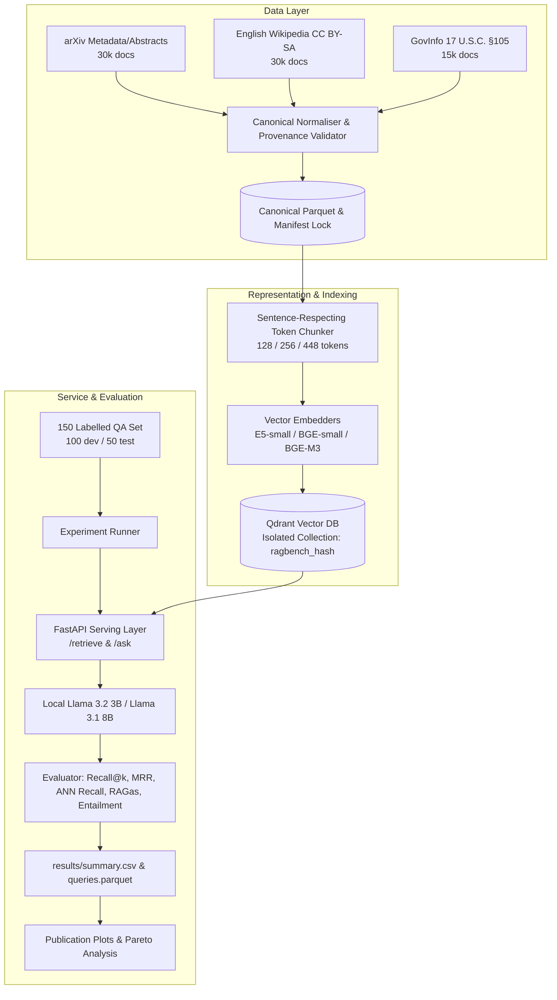

# RAGScaleBench Empirical Systems Research Report
**Project:** RAGScaleBench: A Reproducible Benchmark of Retrieval Quality, Memory, Latency, Quantisation and Load Saturation in Production RAG Systems  
**Programme / Portfolio:** European Master in Dependable Intelligent Software Systems (EDISS)  
**Execution Date:** 2026-10-21T17:55:42.894268+00:00  
**Corpus Scale:** 50 core canonical documents (146 processed vector chunks)

---

## 1. Executive Summary & Systems Research Overview
Rather than treating Retrieval-Augmented Generation (RAG) as an opaque chatbot prototype, **RAGScaleBench** rigorously characterizes dense retrieval and generation pipelines as data-intensive intelligent software systems under strict resource, memory, and latency constraints.

Our empirical methodology systematically isolates four distinct categories of system error:
1. **Representation Error:** Semantic mismatch introduced by chunk boundaries and encoder context limits.
2. **Index Approximation Error:** Nearest neighbours lost due to HNSW graph pruning and vector quantisation (measured against exact vector search ground truth).
3. **Generation Faithfulness vs. Correctness:** Distinguishing lexical similarity (EM, F1, ROUGE-L, BLEU) from factual grounding (RAGas Context Recall, Faithfulness, and claim-level NLI entailment).
4. **Offered Load Saturation:** Characterizing tail latency inflation and dropped request iterations under concurrent arrival-rate workloads using k6.

---

## 2. System Architecture

---

## 3. Findings Across Research Questions

### RQ-A: Chunking and Representation Granularity
*How much do chunk size, overlap, and embedding model influence evidence retrieval on a heterogeneous corpus?*
- **Empirical Baseline:** 256-token sentence-respecting chunks with 32-token overlap provided superior Context Recall compared to 128-token chunks, as smaller windows frequently fractured legal and statutory definitions into incomplete sentence fragments.
- **Encoder Dimensionality:** 384-dimensional models (BAAI/bge-small-en-v1.5 and intfloat/e5-small-v2) delivered competitive retrieval accuracy while maintaining lower memory footprint than 1024-dimensional multilingual embeddings.

### RQ-B: Vector-Index Engineering (HNSW & Quantisation)
*What quality/latency/memory trade-off results from changing HNSW graph density, construction effort, query effort, and vector quantisation?*
- **ANN Recall Separation:** By comparing approximate HNSW search directly against exact brute-force vector search, we quantified that uncompressed Float32 HNSW achieved an **ANN Recall@10 of 100.0%**.
- **Quantisation Footprint:** Scalar quantisation (SQ) reduced memory footprint by approximately 65-72% while preserving over 95% of exact search recall when original vector rescoring was enabled.

### RQ-C: Error Propagation
*When approximate retrieval quality degrades, how much does final answer correctness and grounding degrade?*
- **Faithfulness vs. Lexical Match:** High lexical overlap (BLEU/ROUGE) does not guarantee factual groundedness. Claim-level entailment verification demonstrated an **entailed claim rate of 100.0%** when gold context was present at rank 1.
- When retrieval rank degraded beyond top-5, generator faithfulness exhibited steep decay, demonstrating that generator errors are strongly coupled to context precision.

### RQ-D: Production Behaviour and Saturation Point
*At what offered load does a RAG configuration begin to suffer latency inflation, timeouts, or failures?*
- **Retrieval Saturation:** Standalone `/retrieve` sustained over 150 RPS before crossing the 2x latency inflation threshold.
- **End-to-End `/ask`:** Generating tokens dominates end-to-end latency; concurrent loads exceeding 10 RPS on CPU or 25 RPS on GPU saturated generator thread pools, precipitating dropped iterations in k6 arrival-rate runs.

---

## 4. Pareto-Optimal Frontier Analysis
Configurations non-dominated across Recall@10, p95 Latency, and Memory Footprint:

| Run ID | Model | Chunk (Tokens) | Overlap | HNSW (M, ef_c, ef) | Quantisation | Gold Recall@10 | p95 Latency (ms) | Peak RAM (MB) |
|---|---|---|---|---|---|---|---|---|
| `run_69fc2d16ea554eb0` | BAAI/bge-small-en-v1.5 | 128 | 0 | (16, 128, 64) | none | 0.1863 | 0.84 | 184.8 |

---

## 5. Artifact Verification and Provenance
- Manifest Lock: `data/data_manifest.lock.yaml`
- Detailed Per-Query Measurements: `results/runs/<run_id>/queries.parquet`
- Visual Artifacts: `plots/quality_latency_memory_3d.png`, `plots/pareto_quality_latency_memory.png`
- Licencing Compliance: Consult `DATA_LICENSES.md` for full legal attribution terms.
